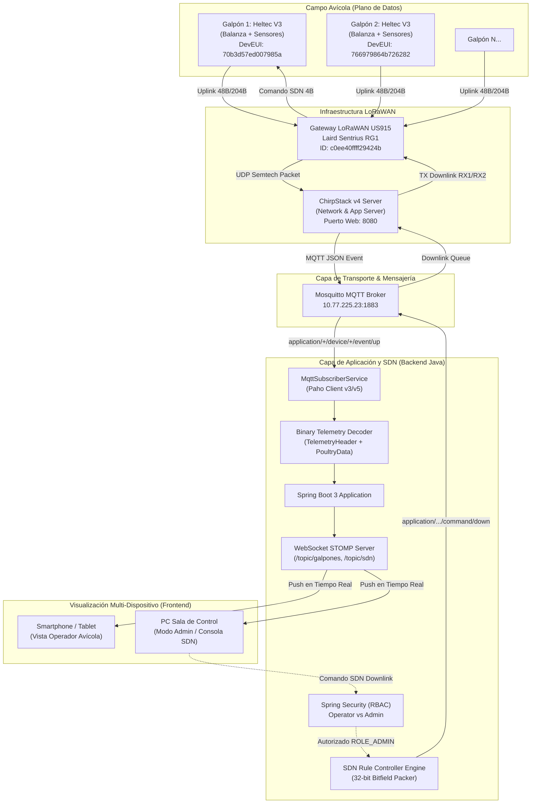

# Especificación de Requerimientos: Dashboard Web de Monitoreo Avícola y Control SDN LoRaWAN

**Proyecto:** Monitoreo de Galpones Avícolas con Control de Plano SDN (RFC 7426) sobre LoRaWAN  
**Servidor Central / Broker:** `10.77.225.23` (Tailscale: `100.101.226.92`) | Puerto MQTT: `1883`  
**ChirpStack Application ID:** `44d003ef-2bd1-480a-84cf-87ff6dc27506` (`lora-iccs`)  
**Fecha de Elaboración:** Noviembre 2026  
**Versión:** 1.0.0  

---

## 1. Resumen Ejecutivo y Viabilidad Tecnológica de Java

### 1.1 ¿Se puede hacer una aplicación web con Java para este propósito?
**Sí, absolutamente.** De hecho, el ecosistema **Java (específicamente con Spring Boot 3)** es uno de los estándares industriales más robustos y consolidados para arquitecturas de IoT de misión crítica, sistemas SCADA y plataformas de control SDN.

### 1.2 Justificación de la Arquitectura con Java
1. **Concurrencia y Estabilidad de Red:** Las librerías cliente MQTT de Java (como **Eclipse Paho MQTT v3/v5**) ofrecen manejo nativo de hilos de alto rendimiento, reconexión automática resiliente con backoff exponencial y buffers de mensajes sin pérdida.
2. **WebSockets Nativos (Spring STOMP):** Permite propagar los eventos recibidos del broker MQTT a todos los navegadores conectados en **menos de 5 milisegundos**, sin necesidad de que el cliente web haga peticiones continuas (*polling*).
3. **Manejo Binario Exacto:** Java proporciona `java.nio.ByteBuffer` con soporte explícito de endianness (`ByteOrder.LITTLE_ENDIAN`), lo cual garantiza una decodificación sin errores de los paquetes binarios flotantes (IEEE 754) provenientes del ESP32/Heltec V3.
4. **Seguridad y Modo Privilegiado (Spring Security):** Implementación directa y formal de **Control de Acceso Basado en Roles (RBAC)**:
   - `ROLE_OPERADOR`: Acceso a paneles de monitoreo de galpones, peso de tolva, gráficas y niveles de comida.
   - `ROLE_ADMIN` / `ROLE_SDN`: Acceso al panel de control SDN para inyectar reglas de radio (SF, potencia, intervalo de transmisión, forzado de modo reposo, reinicio remoto de hardware).
5. **Multi-dispositivo (Responsive Design):** La interfaz web (desarrollada con HTML5 + TailwindCSS/Bootstrap 5 + Chart.js, o desacoplada con Vue/React) es 100% responsiva y adaptable a smartphones, tablets y pantallas de escritorio/sala de control.

---

## 2. Arquitectura General del Sistema



---

## 3. Especificación del Protocolo MQTT

### 3.1 Parámetros de Conexión al Broker
- **Host / IP:** `10.77.225.23` (acceso directo en LAN) o `100.101.226.92` (acceso remoto vía Tailscale VPN).
- **Puerto:** `1883` (TCP sin cifrado) o `8883` (MQTTS con TLS opcional).
- **Client ID del Dashboard:** `sdn-poultry-dashboard-backend` (debe ser único).
- **Clean Session:** `false` (para suscripción persistente) o `true` con reconexión automática.
- **Keep Alive:** `60 segundos`.

---

### 3.2 Tópicos de Suscripción (Uplink / Recepción de Telemetría)

El backend Java debe suscribirse al tópico comodín para capturar todos los nodos asociados a la aplicación:
```text
application/44d003ef-2bd1-480a-84cf-87ff6dc27506/device/+/event/up
```
*(O de manera genérica: `application/+/device/+/event/up`)*

#### Estructura del Mensaje JSON Publicado por ChirpStack:
```json
{
  "deduplicationId": "5c4d08ee-55cf-4df5-a75e-04d80a149a42",
  "time": "2026-11-11T14:48:38.225880+00:00",
  "deviceInfo": {
    "tenantId": "52f14cd4-c6f1-4402-8edc-497d512a8656",
    "tenantName": "ChirpStack",
    "applicationId": "44d003ef-2bd1-480a-84cf-87ff6dc27506",
    "applicationName": "lora-iccs",
    "deviceProfileId": "732b137e-6132-4e4b-97e3-0d33e5c9a419",
    "deviceProfileName": "us915-otaa-profile",
    "deviceName": "heltec-v3-original",
    "devEui": "70b3d57ed007985a"
  },
  "devAddr": "01655b38",
  "fCnt": 4,
  "fPort": 10,
  "data": "BAAAAAMJAAC0QAAAUAAAIEQFAAAAAAAAZr8/AADAfwwB4D+amZk9AAAAAAAAAAAEAAAAAAAAAGi/PwAAwH8MAeA/mpmZP...",
  "rxInfo": [
    {
      "gatewayId": "c0ee40ffff29424b",
      "uplinkId": 45142,
      "gwTime": "2026-11-11T14:48:38.225880+00:00",
      "rssi": -27,
      "snr": 13.5,
      "context": "AAAAAAAAAAA="
    }
  ],
  "txInfo": {
    "frequency": 902300000,
    "modulation": {
      "lora": {
        "bandwidth": 125000,
        "spreadingFactor": 7,
        "codeRate": "CR_4_5"
      }
    }
  }
}
```

---

### 3.3 Tópicos de Publicación (Downlink / Envío de Comandos SDN)

Para enviar una regla de control a un nodo específico, el backend Java debe publicar en el siguiente tópico:
```text
application/{application_id}/device/{dev_eui}/command/down
```
**Ejemplo de tópico para el Galpón 1:**
```text
application/44d003ef-2bd1-480a-84cf-87ff6dc27506/device/70b3d57ed007985a/command/down
```

#### Formato JSON Requerido por ChirpStack v4:
```json
{
  "devEui": "70b3d57ed007985a",
  "confirmed": false,
  "fPort": 10,
  "data": "EAcAAA=="
}
```
*Donde `"data"` es la cabecera SDN empaquetada de 4 bytes codificada en **Base64**.*

---

## 4. Estructura Detallada de los Datos

### 4.1 Datos Recibidos (Uplink Telemetry)

Cada paquete contiene información a dos niveles:
1. **Metadatos de Red (ChirpStack JSON):** Calidad de señal y estado del canal.
2. **Carga Útil Binaria (`data` en Base64):** Telemetría ambiental y física del galpón.

#### A. Metadatos de Red y Calidad RF
| Parámetro | Tipo | Origen | Descripción |
| :--- | :--- | :--- | :--- |
| `devEui` | String (Hex 16) | ChirpStack | Identificador único del nodo en el galpón |
| `deviceName` | String | ChirpStack | Nombre amigable del galpón / tolva |
| `fCnt` | Entero | ChirpStack | Contador de tramas de subida |
| `fPort` | Entero (1..223) | ChirpStack | Puerto LoRaWAN (10 para telemetría) |
| `rssi` | Float (dBm) | `rxInfo[0].rssi` | Potencia de señal recibida (-120 a -20 dBm) |
| `snr` | Float (dB) | `rxInfo[0].snr` | Relación señal a ruido (-15 a +15 dB) |
| `gatewayId` | String (Hex 16) | `rxInfo[0].gatewayId` | Identificador del gateway receptor |
| `frequency` | Entero (Hz) | `txInfo.frequency` | Frecuencia del canal US915 (ej: 902.3 MHz) |
| `spreadingFactor` | Entero (7..10) | `txInfo.modulation` | Factor de ensanchamiento activo en el nodo |

#### B. Estructura Binaria de la Carga Útil (48 Bytes a 204 Bytes)
La carga útil se deserializa de manera secuencial Little-Endian:

##### 1. Cabecera Estándar de Telemetría (`TelemetryHeader` - 24 Bytes)
| Offset (Bytes) | Tamaño | Tipo | Campo | Unidad / Rango | Descripción |
| :---: | :---: | :---: | :--- | :---: | :--- |
| `0 - 3` | 4 B | `uint32_t` | `seq` | Entero incremental | Secuencia del paquete emitida por el nodo |
| `4 - 7` | 4 B | `uint32_t` | `uptime_ms` | Milisegundos | Tiempo de operación continuo del microcontrolador |
| `8 - 11` | 4 B | `float` (IEEE 754) | `battery_mv` | Milivoltios (mV) | Voltaje de alimentación / batería del Heltec V3 |
| `12 - 15` | 4 B | `float` (IEEE 754) | `temperature` | Grados Celsius (°C) | Temperatura ambiente del galpón |
| `16 - 19` | 4 B | `float` (IEEE 754) | `humidity` | Porcentaje (% RH) | Humedad relativa del galpón |
| `20 - 23` | 4 B | `float` (IEEE 754) | `pressure` | Hectopascales (hPa) | Presión barométrica ambiental |

##### 2. Datos de la Balanza de Alimento Avícola (`PoultryScaleData` - 24 Bytes)
| Offset (Bytes) | Tamaño | Tipo | Campo | Unidad / Rango | Descripción |
| :---: | :---: | :---: | :--- | :---: | :--- |
| `24 - 27` | 4 B | `float` (IEEE 754) | `weight_kg` | Kilogramos (kg) | **Peso neto de alimento en tolva** (Lectura - Tara) |
| `28 - 31` | 4 B | `float` (IEEE 754) | `gross_weight_kg` | Kilogramos (kg) | Peso bruto total de la tolva |
| `32 - 35` | 4 B | `float` (IEEE 754) | `voltage_v` | Voltios (V) | Voltaje acondicionado de la celda de carga (0 - 3.3V) |
| `36 - 37` | 2 B | `uint16_t` | `adc_raw` | 0 a 4095 | Lectura digital cruda del ADC del ESP32 |
| `38 - 41` | 4 B | `float` (IEEE 754) | `cal_slope` | V / kg | Factor de calibración activo en el nodo |
| `42 - 45` | 4 B | `float` (IEEE 754) | `cal_zero` | Voltios (V) | Voltaje de referencia de cero en el nodo |
| `46 - 47` | 2 B | `uint16_t` | `time_on_air_ms` | Milisegundos (ms) | Tiempo en el aire (ToA) de la última transmisión |

##### 3. Relleno Opcional / Modo Extendido
- En modo **FULL_TELEMETRY (Modo 0)**: Se anexan 156 bytes adicionales para completar los 204 bytes del estándar SDN para diagnóstico de canal.
- En modo **CRITICAL (Modo 1)**: El payload tiene exactamente 48 bytes (ideal para SF8 / DR2 en US915 para evitar exceder el límite regional de 125 bytes).
- En modo **DIAGNOSTIC (Modo 2)**: El payload tiene 24 bytes (solo `TelemetryHeader`).

---

### 4.2 Datos Enviados (Downlink SDN Control Plane)

El plano de control SDN inyecta reglas empaquetadas en una estructura de **32 bits (4 bytes)** con orden Little-Endian (`SdnHeader`):

```text
 31                          17 16 15 14 13   11 10    7 6    4 3    0
+------------------------------+--+-----+-------+-------+------+------+
|         param_value          |S | PM  |  SR   |  TXP  |  SF  | CMD  |
|          (15 bits)           |1b| 2b  | 3b    |  4b   |  3b  |  4b  |
+------------------------------+--+-----+-------+-------+------+------+
```

#### Desglose Bit a Bit del `SdnHeader`:

| Campo | Rango de Bits | Ancho | Rango Válido | Descripción y Mapeo |
| :--- | :---: | :---: | :---: | :--- |
| `cmd_id` | **0 - 3** | 4 bits | `0 - 15` | **Identificador del Comando SDN:**<br/>• `0x00`: NOP / Keep-Alive (sin alterar parámetros)<br/>• `0x01`: RECONFIG_RADIO (aplica SF, TX Power, Sample Rate)<br/>• `0x02`: SET_TEMP_THRESHOLD (define umbral en `param_value`)<br/>• `0x03`: FORCE_SLEEP (fuerza reposo profundo)<br/>• `0x04`: SET_P2P_RELAY (activa retransmisión P2P)<br/>• `0x0F`: SYSTEM_RESET (reinicio por software del ESP32) |
| `sf_target` | **4 - 6** | 3 bits | `0 - 7` | **Spreading Factor Objetivo (LUT):**<br/>• `0`: SF7 (DR3 en US915)<br/>• `1`: SF8 (DR2 en US915)<br/>• `2`: SF9 (DR1 en US915)<br/>• `3`: SF10 (DR0 en US915)<br/>• `4`: SF11 \| `5`: SF12 |
| `tx_power` | **7 - 10** | 4 bits | `0 - 15` | **Potencia de Transmisión RF:**<br/>• Valor en dBm directo (ej: `14` = 14 dBm, `2` = 2 dBm) |
| `sample_rate` | **11 - 13** | 3 bits | `0 - 7` | **Intervalo de Transmisión Periódica (LUT):**<br/>• `0`: 10 segundos (Modo prueba / Alarma)<br/>• `1`: 60 segundos (1 minuto)<br/>• `2`: 300 segundos (5 minutos)<br/>• `3`: 900 segundos (15 minutos)<br/>• `4`: 1800 segundos (30 minutos)<br/>• `5`: 3600 segundos (1 hora)<br/>• `6`: 14400 segundos (4 horas)<br/>• `7`: 86400 segundos (24 horas) |
| `payload_mode`| **14 - 15**| 2 bits | `0 - 3` | **Modo de Empaquetado:**<br/>• `0`: FULL_TELEMETRY (204 bytes)<br/>• `1`: CRITICAL (48 bytes - Headers + Balanza)<br/>• `2`: DIAGNOSTIC (24 bytes - Solo estado MCU) |
| `sleep_enable`| **16** | 1 bit | `0 - 1` | `1` habilita modo Deep Sleep entre intervalos; `0` mantiene el radio activo |
| `param_value` | **17 - 31**| 15 bits| `0 - 32767` | Parámetro numérico auxiliar (ej: umbral de temperatura en centésimas de grado: `2850` = 28.50 °C) |

---

## 5. Requerimientos de la Interfaz y Modos de Acceso

### 5.1 Adaptabilidad Multi-Dispositivo (Responsive Design)
La aplicación web debe renderizarse de forma fluida en tres formatos principales:

```text
+-----------------------+-----------------------------+-------------------------------+
| Móvil (< 768px)       | Tablet (768px - 1024px)     | Escritorio (> 1024px)         |
+-----------------------+-----------------------------+-------------------------------+
| - Vista vertical      | - Tarjetas en cuadrícula    | - Vista panorámica multi-panel|
| - Tarjeta resumen     |   de 2 columnas             | - Dashboard tiempo real       |
| - Barra de tolva (%)  | - Gráficas táctiles         | - Gráficas lado a lado        |
| - Indicador semáforo  | - Panel SDN colapsable      | - Consola SDN persistente     |
| - Alerta de recarga   |                             | - Terminal de tramas y logs   |
+-----------------------+-----------------------------+-------------------------------+
```

---

### 5.2 Modo Operador Avícola (Acceso Estándar - Solo Lectura)
Diseñado para el personal encargado del galpón y veterinarios:
1. **Tarjeta de Monitoreo por Galpón:**
   - Nombre del Galpón (ej. *Galpón 1 - Lote Aves Broiler*).
   - Nivel de Tolva en Porcentaje (`%`) con barra de progreso de color:
     - 🟢 **Verde (> 50%):** Nivel adecuado.
     - 🟡 **Amarillo (20% - 50%):** Nivel medio.
     - 🔴 **Rojo (< 20%):** Alerta crítica de recarga urgente de alimento.
   - Peso Neto Actual en Kilogramos (`weight_kg`).
   - Temperatura Ambiente (`°C`) y Humedad Relativa (`%`).
   - Estado de Batería del Sensor (`mV`) y Calidad de Señal LoRa (`RSSI / SNR`).
   - Hora del último reporte (*hace X segundos / minutos*).
2. **Gráficas de Consumo:**
   - Curva de consumo diario de alimento (pendiente negativa del peso respecto al tiempo).
   - Historial de temperatura y humedad de las últimas 24 horas.

---

### 5.3 Modo Privilegiado / Ingeniero SDN (Acceso Administrador)
Protegido por autenticación de usuario con rol `ROLE_ADMIN`:
1. **Control Centralizado de Topología SDN:**
   - Selector dinámico de nodo por su `devEui`.
   - Selector de **Spreading Factor** (SF7 a SF12).
   - Selector de **Potencia de Transmisión** (2 a 14 dBm).
   - Selector de **Intervalo de Transmisión** (10 seg hasta 24 horas).
   - Selector de **Modo de Payload** (FULL 204B vs CRITICAL 48B).
   - Interruptor de **Modo Reposo / Deep Sleep**.
   - Botón de **Reinicio Remoto (SYSTEM_RESET)** con diálogo de confirmación.
2. **Consola de Tráfico y Diagnóstico RF:**
   - Visualizador de tramas brutas (Hex Dump).
   - Comparador de paquetes esperados vs recibidos (fCnt tracker).
   - Historial de reglas inyectadas y acuses de recibo (ACK Downlink).
3. **Calibración Remota de la Balanza:**
   - Botón de Tara Remota (fijar peso neto en 0.00 kg).
   - Ajuste de constante de calibración `cal_slope` y `cal_zero`.

---

## 6. Arquitectura Técnica de Implementación en Java (Spring Boot 3)

### 6.1 Dependencias Maven Recomendadas (`pom.xml`)
```xml
<dependencies>
    <!-- Spring Boot Web & WebSockets -->
    <dependency>
        <groupId>org.springframework.boot</groupId>
        <artifactId>spring-boot-starter-web</artifactId>
    </dependency>
    <dependency>
        <groupId>org.springframework.boot</groupId>
        <artifactId>spring-boot-starter-websocket</artifactId>
    </dependency>

    <!-- Spring Security para Modo Privilegiado -->
    <dependency>
        <groupId>org.springframework.boot</groupId>
        <artifactId>spring-boot-starter-security</artifactId>
    </dependency>

    <!-- Cliente MQTT Eclipse Paho v3 -->
    <dependency>
        <groupId>org.eclipse.paho</groupId>
        <artifactId>org.eclipse.paho.client.mqttv3</artifactId>
        <version>1.2.5</version>
    </dependency>

    <!-- Procesamiento JSON (Jackson) -->
    <dependency>
        <groupId>com.fasterxml.jackson.core</groupId>
        <artifactId>jackson-databind</artifactId>
    </dependency>

    <!-- Persistencia Opcional (PostgreSQL / TimescaleDB) -->
    <dependency>
        <groupId>org.springframework.boot</groupId>
        <artifactId>spring-boot-starter-data-jpa</artifactId>
    </dependency>
    <dependency>
        <groupId>org.postgresql</groupId>
        <artifactId>postgresql</artifactId>
    </dependency>
</dependencies>
```

---

### 6.2 Lógica de Empaquetamiento de Reglas SDN en Java (`SdnHeaderPacker.java`)

```java
package com.sdn.poultry.protocol;

import java.nio.ByteBuffer;
import java.nio.ByteOrder;
import java.util.Base64;

/**
 * Empaquetador de Cabecera SDN (32 bits / 4 bytes) según RFC 7426
 */
public class SdnHeaderPacker {

    public static byte[] packSdnHeader(
            int cmdId,       // 4 bits (0..15)
            int sfTarget,    // 3 bits (0..7)
            int txPower,     // 4 bits (0..15)
            int sampleRate,  // 3 bits (0..7)
            int payloadMode, // 2 bits (0..3)
            int sleepEnable, // 1 bit  (0..1)
            int paramValue   // 15 bits (0..32767)
    ) {
        long word32 = 0L;
        word32 |= (cmdId & 0x0FL);
        word32 |= ((sfTarget & 0x07L) << 4);
        word32 |= ((txPower & 0x0FL) << 7);
        word32 |= ((sampleRate & 0x07L) << 11);
        word32 |= ((payloadMode & 0x03L) << 14);
        word32 |= ((sleepEnable & 0x01L) << 16);
        word32 |= ((paramValue & 0x7FFFL) << 17);

        ByteBuffer buffer = ByteBuffer.allocate(4);
        buffer.order(ByteOrder.LITTLE_ENDIAN);
        buffer.putInt((int) word32);
        return buffer.array();
    }

    public static String toChirpStackBase64(byte[] packedHeader) {
        return Base64.getEncoder().encodeToString(packedHeader);
    }
}
```

---

### 6.3 Decodificador de Telemetría Binaria en Java (`TelemetryDecoder.java`)

```java
package com.sdn.poultry.protocol;

import java.nio.ByteBuffer;
import java.nio.ByteOrder;

public class TelemetryDecoder {

    public static PoultryTelemetryDTO decode(byte[] payloadBytes) {
        if (payloadBytes == null || payloadBytes.length < 48) {
            throw new IllegalArgumentException("Payload insuficiente para telemetría avícola (< 48 bytes)");
        }

        ByteBuffer buffer = ByteBuffer.wrap(payloadBytes);
        buffer.order(ByteOrder.LITTLE_ENDIAN);

        PoultryTelemetryDTO dto = new PoultryTelemetryDTO();

        // 1. TelemetryHeader (24 Bytes)
        dto.setSeq(Integer.toUnsignedLong(buffer.getInt()));
        dto.setUptimeMs(Integer.toUnsignedLong(buffer.getInt()));
        dto.setBatteryMv(buffer.getFloat());
        dto.setTemperature(buffer.getFloat());
        dto.setHumidity(buffer.getFloat());
        dto.setPressure(buffer.getFloat());

        // 2. PoultryScaleData (24 Bytes)
        dto.setWeightKg(buffer.getFloat());
        dto.setGrossWeightKg(buffer.getFloat());
        dto.setVoltageV(buffer.getFloat());
        dto.setAdcRaw(buffer.getShort() & 0xFFFF);
        dto.setCalSlope(buffer.getFloat());
        dto.setCalZero(buffer.getFloat());
        dto.setTimeOnAirMs(buffer.getShort() & 0xFFFF);

        // Cálculo de nivel de tolva (ej. capacidad base de 20.0 kg)
        float maxCapacity = 20.0f;
        float hopperPct = Math.max(0.0f, Math.min(100.0f, (dto.getWeightKg() / maxCapacity) * 100.0f));
        dto.setHopperPercentage(hopperPct);

        return dto;
    }
}
```

---

### 6.4 Servicio de Suscripción MQTT y Push WebSocket (`MqttClientService.java`)

```java
package com.sdn.poultry.service;

import com.fasterxml.jackson.databind.JsonNode;
import com.fasterxml.jackson.databind.ObjectMapper;
import com.sdn.poultry.protocol.PoultryTelemetryDTO;
import com.sdn.poultry.protocol.TelemetryDecoder;
import org.eclipse.paho.client.mqttv3.*;
import org.springframework.messaging.simp.SimpMessagingTemplate;
import org.springframework.stereotype.Service;

import jakarta.annotation.PostConstruct;
import java.util.Base64;

@Service
public class MqttClientService implements MqttCallbackExtended {

    private final SimpMessagingTemplate messagingTemplate;
    private final ObjectMapper objectMapper = new ObjectMapper();
    private MqttAsyncClient client;

    private final String BROKER_URL = "tcp://10.77.225.23:1883";
    private final String TOPIC_UPLINK = "application/+/device/+/event/up";

    public MqttClientService(SimpMessagingTemplate messagingTemplate) {
        this.messagingTemplate = messagingTemplate;
    }

    @PostConstruct
    public void start() throws MqttException {
        client = new MqttAsyncClient(BROKER_URL, "spring-poultry-backend");
        client.setCallback(this);

        MqttConnectOptions options = new MqttConnectOptions();
        options.setAutomaticReconnect(true);
        options.setCleanSession(true);
        options.setConnectionTimeout(10);

        client.connect(options).waitForCompletion();
    }

    @Override
    public void connectComplete(boolean reconnect, String serverURI) {
        try {
            client.subscribe(TOPIC_UPLINK, 1);
            System.out.println("Subscrito a eventos LoRaWAN: " + TOPIC_UPLINK);
        } catch (MqttException e) {
            e.printStackTrace();
        }
    }

    @Override
    public void messageArrived(String topic, MqttMessage message) throws Exception {
        JsonNode root = objectMapper.readTree(message.getPayload());

        String devEui = root.path("deviceInfo").path("devEui").asText();
        String dataB64 = root.path("data").asText();

        double rssi = root.path("rxInfo").path(0).path("rssi").asDouble();
        double snr = root.path("rxInfo").path(0).path("snr").asDouble();

        if (!dataB64.isEmpty()) {
            byte[] payloadBytes = Base64.getDecoder().decode(dataB64);
            PoultryTelemetryDTO telemetry = TelemetryDecoder.decode(payloadBytes);
            telemetry.setDevEui(devEui);
            telemetry.setRssi(rssi);
            telemetry.setSnr(snr);

            // Reenvío inmediato a clientes web conectados vía WebSockets
            messagingTemplate.convertAndSend("/topic/telemetria/" + devEui, telemetry);
            messagingTemplate.convertAndSend("/topic/galpones/resumen", telemetry);
        }
    }

    @Override public void connectionLost(Throwable cause) {}
    @Override public void deliveryComplete(IMqttDeliveryToken token) {}
}
```

---

## 7. Plan de Implementación por Fases

| Fase | Alcance | Entregables |
| :---: | :--- | :--- |
| **Fase 1** | **Backend Base Spring Boot & Conectividad MQTT** | • Configuración Maven con Paho MQTT y WebSockets.<br/>• Decodificador binario Little-Endian.<br/>• Suscripción a tópicos de ChirpStack y pruebas unitarias con tramas reales. |
| **Fase 2** | **Capa de Notificación en Tiempo Real (WebSockets STOMP)** | • Configuración de WebSocket Broker.<br/>• Emisión de eventos reactivos al llegar cada Uplink.<br/>• Endpoint REST para consultar el último estado en caché. |
| **Fase 3** | **Interfaz de Usuario Responsiva (Modo Operador)** | • Vistas adaptables (Móvil/Tablet/Escritorio).<br/>• Tarjetas dinámicas de tolva con nivel de comida y semáforos.<br/>• Gráficas en tiempo real con Chart.js de peso y temperatura. |
| **Fase 4** | **Seguridad y Consola de Control SDN (Modo Privilegiado)** | • Spring Security con Login y roles (`ROLE_OPERADOR`, `ROLE_ADMIN`).<br/>• Formulario interactivo para inyección de reglas (SF, Potencia, Intervalo).<br/>• Generador Base64 y publicador de comandos al tópico `.../command/down`. |
| **Fase 5** | **Pruebas Integradas y Despliegue** | • Validación de enlace extremo a extremo con el nodo Heltec V3 (`70b3d57ed007985a`).<br/>• Dockerización opcional del aplicativo Java para integrarlo al `docker-compose.yml`. |

---
*Documento generado y alineado con los estándares del proyecto LoRaWAN-SDN (RFC 7426) y el servidor central de control.*
