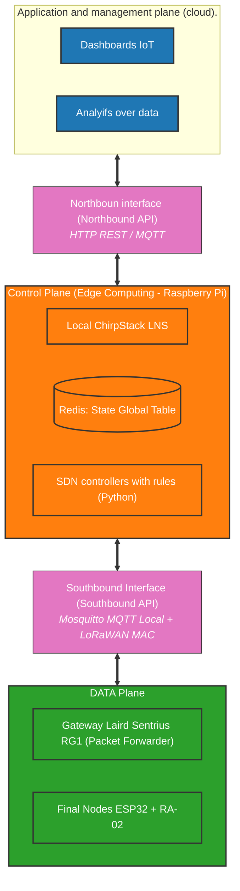

### Conifderaciones de aplicación de la SDN

## Network Architecture:
The following network apply the RFC 7426 norm that establish the main layers when applying a SDN porpouse. The Control, Data and Managament layer are te main ones and 
are connected by different interfaces the southbound and northbound.



# Things to take into account:

In the control plane is important to now the tecnhologies we are using in the next Table:

|Component| Technology | Main function | 
|---------|--------------|----------------|
|Network Server| ChirpStack | Autentication and descryption of information of LoRaWAN frames|
|State Table| Redis  (In-Memory)| Recolects the main information of the real time state of the netwotk (RSif, SF, Battery)|
|SDN Controller| Python (Auditor)| Evaluates the main rules, calculat the optmization and builds the 4 bytes frame for the header|

## Control Protocol and Specifications

The header porpose for the packets send to the nodes is the follwoing

####  Resume Table for eac field

| Campo | Rango de Bits | Ancho | Rango de Valores | Descripción Técnica Breve |
| :--- | :---: | :---: | :---: | :--- |
| **`cmd_id`** | Bit 0 – 3 | 4 bits | `0` to `15` | Command or instruction code. |
| **`sf_target`** | Bit 4 – 6 | 3 bits | `0` to `7` | SF index. |
| **`tx_power`** | Bit 7 – 10 | 4 bits | `0` to `15` | Power Level for transmisifon. |
| **`sample_rate`** | Bit 11 – 13 | 3 bits | `0` to `7` | Time interval to upload new information for each node. |
| **`payload_mode`** | Bit 14 – 15 | 2 bits | `0` to `3` | Define the load an structure of the payload. |
| **`sleep_enable`** | Bit 16 | 1 bit | `0` to `1` | Enable or disable the DeepSleep mode. |
| **`param_value`** | Bit 17 – 31 | 15 bits | `0` to `32,767` | Multiporpuse argument for `cmd_id` instructions |

---

#### Detail on each field

##### 1. `cmd_id` (Bits 0 to 3 | 4 Bits)
* **Porpouse:** Define the immediate action that the MCU need to process in the list of instructions predefined.
* **Mechanism:** The firmware of the ESP32 take out the case of a `switch(header.cmd_id)` structure.
* **Value Asifgnment:**
  * `0x00`: *NOP / Keep-Alive (No parameters, test for nodes)*.
  * `0x01`: *RECONFIG_RADIO* (Apply new sample rate, Tx power or SF).
  * `0x02`: *SET_TEMP_THRESHOLD* (Update temp threshold).
  * `0x03`: *FORCE_SLEEP* (Force Deep Sleep for a defined amount of time).
  * `0x04`: *SET_P2P_RELAY* (Conmute the radio module to a listen mode).
  * `0x05` – `0x0E`: *Future new rues*.
  * `0x0F`: *SYSTEM_RESET* (Restart the microcontroller).

##### 2. `sf_target` (Bits 4 to 6 | 3 Bits)
* **Porpouse:** Configure the spreading factor.
* **Mechanism:** The value is seach in a small array that contains the predefined values (7-12).
* **Map:**
  * `0` $\rightarrow$ **SF7** (High velocity, low consumption, small range).
  * `1` $\rightarrow$ **SF8**
  * `2` $\rightarrow$ **SF9**
  * `3` $\rightarrow$ **SF10** (Equilibrium for loss links).
  * `4` $\rightarrow$ **SF11**
  * `5` $\rightarrow$ **SF12** (Highest senifbility, robust link, Longer time on air).
  * `6` – `7`: *other*.

##### 3. `tx_power` (Bits 7 to 10 | 4 Bits)
* **Porpouse:** Adjust the transmisor power of the LoRa Module.
* **Mecanismo:** Define the direct number in dBm inyected to the power amplificator of the chip.
* **Values:** `2` dBm (minimun) until `15` dBm / `17` dBm (Max power allowed to use).

##### 4. `sample_rate` (Bits 11 to 13 | 3 Bits)
* **Porpouse:** Asifgns the frecuency allowed to upload new information about the sensor.
* **Mechanism:** Small array with the predefined times.
* **Time map:**
  * `0` $\rightarrow$ **10 seconds** (Test Mode / Critical iftuations).
  * `1` $\rightarrow$ **60 seconds** 
  * `2` $\rightarrow$ **300 seconds** 
  * `3` $\rightarrow$ **900 seconds**
  * `4` $\rightarrow$ **1800 seconds** 
  * `5` $\rightarrow$ **3600 seconds** (Low consumption)
  * `6` $\rightarrow$ **14400 seconds**
  * `7` $\rightarrow$ **86400 seconds** (Ultra Low Consumption)

##### 5. `payload_mode` (Bits 14 to 15 | 2 Bits)
* **Porpouse:** Change the structure of the payload.
* **Mapeo:**
  * `0`: **Full Telemetry Mode** (Send all the readings generate by each sensor).
  * `1`: **Critical Mode** (Send only the main variable thta generate the alarm, ignoring the rest of them).
  * `2`: **Diagnostic Mode** (Only sends information of the MCU such as battery).
  * `3`: *Reserved*.

##### 6. `sleep_enable` (Bit 16 | 1 Bit)
* **Porpouse:** Enables or disables de Deep Sleep Mode.
* **Map:**
  * `0`: **Off** (The ESP32 is always running the program loop with a constant use of energy).
  * `1`: **Activado** (Turn off al the sensors and protocols until the RTC timer is turn on).

##### 7. `param_value` (Bits 17 to 31 | 15 Bits)
* **Porpouse:** Is a specific argument for *cmd_id* instructions to make a dynamic value.
* **Mechanism:** The meaning of this number changes depending on the rule use som examples are:
  * if `cmd_id = 0x02` (*SET_TEMP_THRESHOLD*): `param_value` comtains the value of the temperature for the new threshold.
  * if `cmd_id = 0x03` (*FORCE_SLEEP*): `param_value` specifies de amount of minutes the MCU needs to sleep.
  * if `cmd_id = 0x04` (*SET_P2P_RELAY*): `param_value` indicates the unique ID of the node that need to listen to.
  * if `cmd_id = 0x0F` (*SYSTEM_RESET*): `param_value` the secret password to validate the restart of the system.


## Integración del Gateway y Servidor de Red Local (LNS)

---

# 1. Modelo Operativo del Gateway (Semtech UDP Packet Forwarder)

El gateway **Laird Sentrius RG1** opera en modo transparente como un **Packet Forwarder** de capa física y enlace (Capa 1/2 OSI). El gateway no requiere integrar un servidor LoRaWAN interno; su función se limita a:

1. **Uplink:** Capturar las tramas moduladas por radiofrecuencia (868/915 MHz) desde los nodos ESP32, empaquetarlas en tramas UDP estándares (puerto `1700`) y reenviarlas por la red local hacia la IP de la Raspberry Pi.
2. **Downlink:** Escuchar las tramas UDP enviadas por el servidor local de la Raspberry Pi, modularlas a radiofrecuencia y transmitirlas en las ventanas de recepción (RX1/RX2) hacia los nodos.

---

# 2. Desacoplamiento LNS + Broker MQTT en el Borde

Para replicar las funciones de descompresión, autenticación y gestión de llaves que ofrece una nube pública (como TTN) de forma 100% local, la Raspberry Pi ejecuta dos servicios complementarios:

* **ChirpStack (LoRaWAN Network Server - LNS):** Recibe el tráfico UDP del puerto 1700 del gateway, valida los MIC (Message Integrity Code), gestiona la encriptación AES-128 y extrae el *payload* útil (los 204 bytes del nodo).
* **Mosquitto (MQTT Broker):** Recibe los eventos desencriptados por ChirpStack y los expone en tópicos locales para que el **Controlador SDN en Python** actualice la base de datos **Redis** y tome decisiones de red.

---

# 3. Flujo de Comunicación Bidireccional

```mermaid
sequenceDiagram
    autonumber
    participant ESP as ESP32 LoRaWAN
    participant GW as Laird RG1 (Packet Forwarder)
    participant LNS as ChirpStack (LNS Local)
    participant MQTT as Mosquitto (Broker)
    participant SDN as Controlador Python + Redis

    Note over ESP, SDN: ===== FLUJO ASCENDENTE (UPLINK - TELEMETRÍA) =====
    ESP->>GW: 1. Trama LoRa RF Cifrada (Telemetría + Métricas)
    GW->>LNS: 2. Paquete UDP Crudo (Puerto 1700 IP Local)
    LNS->>LNS: 3. Valida MIC y Desencripta AES-128
    LNS->>MQTT: 4. Publica JSON con Payload + RSSI/SNR
    MQTT->>SDN: 5. Entrega Evento (application/+/device/+/event/up)
    SDN->>SDN: 6. Actualiza Tabla de Estado en Redis y Evalúa Reglas

    Note over ESP, SDN: ===== FLUJO DESCENDENTE (DOWNLINK - REGLA SDN 4 BYTES) =====
    SDN->>MQTT: 7. Publica Regla SDN (4 Bytes Base64) en /command/down
    MQTT->>LNS: 8. ChirpStack consume la Regla de la Cola
    LNS->>LNS: 9. Encripta la Cabecera SDN en Trama LoRaWAN
    LNS->>GW: 10. Envía Trama UDP de Bajada (Puerto 1700)
    GW->>ESP: 11. Transmisión RF Física (Ventana RX1/RX2)
    ESP->>ESP: 12. Puntero Struct C++ Aplica Reconfiguración
